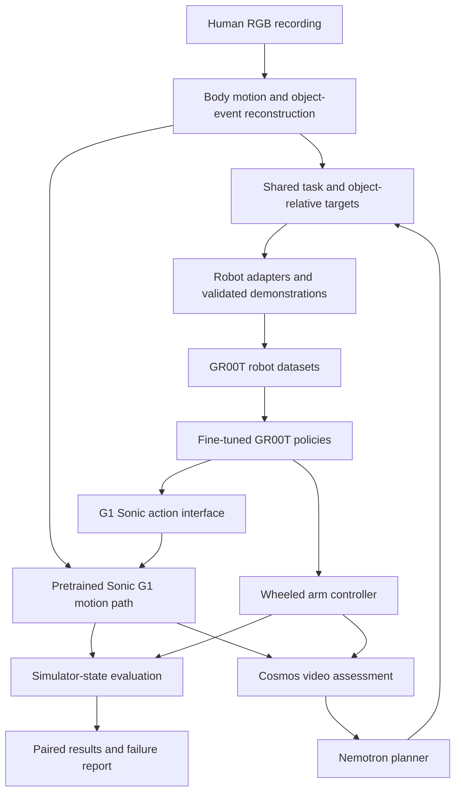

> **HISTORICAL (marked 2026-10-06).** Written for an earlier plan (Nebius VM, two-arm scope). Current state: `DOC_INDEX.md`, `STATUS_AND_OBJECTIVE.md`, `HANDOFF.md`. Nebius and Isaac Sim are out of scope. Kept for the record; do not trust its status claims.

# TransferGap

> ## ⚠️ Before anything else: read the banner at the top of [Implementation Status](Implementation%20Status.md)
> As of Sept 28, 2026 a GPU instance's billing state is unconfirmed and must be verified via the Nebius console or a working CLI before any new work or any claim to the user about cost.

> **Current plan (Sept 30, 2026):** see [[Research Synthesis 2026-09-30]] (final decisions) and [[Agent Handoff]] (state and next actions). Where this note conflicts with the synthesis, the synthesis wins.

> One human demonstration, two robot embodiments: measure where execution fails, diagnose the cause, and test whether a targeted correction improves transfer.

The project remains locked for the Nebius × NVIDIA Physical AI track. The architecture is updated against primary sources and the user's actual robot notes. [Research review](TransferGap%20Research%20Review.md) · [KAIROS stack audit](KAIROS%20Stack%20Audit.md) · [implementation status](Implementation%20Status.md) · [starter code](transfergap/README.md). The [original plan](research/TransferGap-before-audit-2026-09-27.md) is preserved for history.

## Build target

A human RGB recording supplies a source task demonstration. A G1 humanoid and a wheeled single-arm manipulator execute the task in simulation. Measure object outcome, control failures, trajectory error where meaningful, adaptation data, latency and model interventions.

The eventual real target is the user's **older Robotnik KAIROS**. Its documented simulator stack already uses **ROS 2 Humble, UR10, Robotiq controllers, MoveIt2, Nav2 and Isaac Sim 4.2.0**. Exact physical gripper/arm variant and calibration remain unverified. Preserve the working interface; no ROS migration is assumed. Public hackathon assets must be separately reusable; private lab sources and the USD twin have not been copied.

## NVIDIA responsibilities and training decisions

| Component | Functional role | Evidence / decision |
|---|---|---|
| Nemotron | Task-step planning and bounded recovery proposals | Real Nebius Nano inference smoke test passed. **Fine-tuning confirmed NOT supported**: the Token Factory fine-tuning model list (deepseek-ai/DeepSeek-V3-0324, Llama-3.2/3.1/3.3, unsloth/gpt-oss-20b/120b, Qwen3-14B/32B) contains no Nemotron model. Use via inference only. |
| GR00T N1.7 | Learned closed-loop robot actions | Fine-tune projector/action head on valid robot observations/actions. L40S pilot pending; per-embodiment data/configuration required. This is the one confirmed fine-tuning deliverable. |
| Sonic | G1 whole-body control | Use pretrained G1 weights. `--embodiment-tag UNITREE_G1_SONIC` is a real, documented launch config for GR00T fine-tuning against Sonic's interface — de-risks (does not eliminate) the autonomous-upgrade stretch goal. Motion tracking and object manipulation have separate gates. No Sonic training planned. |
| Cosmos-Reason2 | Video event extraction, mismatch assessment and recovery evidence | Endpoint/video test pending. Verify hosted access or provision/run sequentially. No fine-tuning planned. |
| GEM-X | RGB→full-body motion capture, feeding Sonic | Confirmed real: `NVlabs/GEM-X`, NVIDIA's own monocular whole-body (77-joint) pose model, with a documented "Live Camera Teleoperation with GEM-X" tutorial showing camera→GEM-X→Sonic→G1. Use this in place of GVHMR for the humanoid line — a fifth genuine NVIDIA model in real use, not a third-party substitute. |

> **Superseded (Sept 30):** the component list in the table above is superseded by [[Research Synthesis 2026-09-30]] §3: Cosmos 3 Nano reasoner first (Cosmos-Reason2-8B fallback), Kimodo-G1 for G1 correction, cuRoboV2 for arm IK and correction, Nemotron 3 Nano for planning and Nemotron 3 Super for diagnosis. **GR00T fine-tuning is proposed as stretch, not core, pending the user's decision** (recommendation: keep an arm-only pilot as stretch, gated on at least 100 MimicGen-lite episodes); this contradicts the "never cut" line under the build-order table, which is kept as history.

Nemotron's completed call proves inference and a task proposal, not robot execution or fine-tuning. A text model receives structured observations/transcripts; Cosmos handles video. Independent simulator state supplies benchmark labels.

## Architecture

Use the current `UNITREE_G1_SONIC` path for G1 autonomy and a compatible `NEW_EMBODIMENT` configuration for the wheeled arm. Shared task intent does not imply interchangeable action vectors or zero-shot checkpoints. [NVIDIA workflow](https://nvlabs.github.io/GR00T-WholeBodyControl/tutorials/vla_workflow.html).

Prefer a common simulator for the public comparison where practical; Sonic has an official MuJoCo route. Keep the lab Isaac 4.2/ROS environment separate from newer policy dependencies. Calibrate camera/table/tool frames and scale. Hand/body pose alone does not locate objects or guarantee a grasp.

## Defensible contribution

[H2RBench](https://h2rbench.github.io/) already measures human-to-robot transfer, but confirmed by direct check: it evaluates only a **single robot embodiment** and reports failures only illustratively, with no systematic failure attribution or corrective-intervention analysis. Our candidate contribution — this specific **two-embodiment** experiment with **failure attribution and measured corrective interventions** — is not covered by it. No world-first or universal robot-transfer claim is established.

Separate motion tracking, demonstration execution, autonomous policy evaluation and model-assisted recovery. Freeze matched scenes, trial seeds, observation/data budgets, task predicates and time/retry limits. Compare object/tool motion in a common frame, not different robots' joint angles. Report each robot's own achievable baseline and uncertainty.

A two-robot result is an end-to-end system gap, not the isolated effect of legs versus wheels. If G1 autonomy fails, report G1 replay separately rather than compare it with arm autonomy as a matched policy experiment. RGB/RGB-D is secondary and requires matched sensory inputs; estimated monocular depth is not a depth-camera condition.

## Build order and gates

Compressed to leave a **10-day reserved review window before the deadline** (build/test frozen by Oct 19, review Oct 20–29).

| Dates | Deliverable | Gate |
|---|---|---|
| Sept 27–29 | Access confirmed for all five models/endpoints (Nemotron, GR00T, Sonic, Cosmos-Reason2, GEM-X). GEM-X→Sonic loop on one recorded clip in Isaac Sim; WiLoR→dex-retargeting→MuJoCo loop started in parallel | Tracking and physical contact work independently |
| Sept 30–Oct 3 | Both lines replay a full human demo independently (no autonomy yet) — the guaranteed floor | Calibrated replay, valid observation/action records |
| Oct 4–8 | GR00T inference wired into both lines; demo/teleop data collection for fine-tuning begins | Actual peak memory and throughput measured, not assumed |
| Oct 9–12 | GR00T light fine-tune runs (wheeled arm primary; G1-via-`UNITREE_G1_SONIC` is the stretch); Nemotron + Cosmos-Reason2 wired in | If autonomy fails, retain a separately labelled replay comparison |
| Oct 13–16 | **Kill gate:** autonomous GR00T→Sonic works or is dropped for the replay baseline. Paired trials, failure attribution, one correction ablation | Logged outcomes including failures; depth study only if ready |
| Oct 17–19 | Dashboard, packaging, freeze the build | Every advertised capability links to execution evidence |
| Oct 20–29 | **Reserved review window:** fix what review finds, record the demo video, write submission materials | No new features — fixes and polish only |
| Oct 30 | Submit before 10:00 Pacific / 18:00 Berlin | Prefer submitting the previous day |

**If behind schedule, cut in this order:** G1 autonomy (keep the Sonic-replay baseline) → Cosmos-Reason2's role (simplify) → the RGB-D depth ablation. Never cut the two working baselines or the GR00T fine-tune.

Schedule GPU workloads sequentially on the 48 GB L40S. The current GR00T hardware guide supports a light-tuning pilot at this scale, but fit and duration need measurement. Hosted calls have provider cost even when they consume no local VRAM.

The [rules](https://nebiusglobalaihackathon.devpost.com/rules) allow a simulated application-module clip and explicitly mention Nebius Serverless Jobs for Physical AI. Include a meaningful job with recorded output and endpoint usage where needed. Effective model use and a complete product matter; model/fine-tuning count does not establish a prize outcome.

## Current boundary

The starter contains scoring, paired comparisons, robot/action contracts and hosted-call receipts. Its tests pass and Nemotron has been called successfully. No complete robot pipeline, GR00T fine-tune, Sonic rollout, Cosmos inference or hardware execution is claimed. See the status note for evidence and remaining gates.
