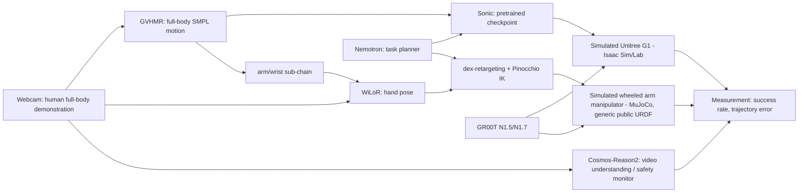

> Historical snapshot preserved before the primary-source audit. Superseded by ../TransferGap.md and ../TransferGap Research Review.md.

---
type: decision
status: locked — building
track: Physical AI
updated: 2026-09-27
tags: [hackathon, nebius, nvidia, groot, cosmos, sonic, mujoco, isaac-sim]
---

# TransferGap

> **One-line pitch:** One camera records a human's full-body demonstration. It drives a simulated legged humanoid (NVIDIA Sonic + GR00T) and a simulated wheeled arm manipulator (GR00T alone) from the same footage — then measures, with real numbers, how much success and accuracy transfer across that embodiment gap, and what a monocular camera costs you versus depth.

## Decision — locked

Build **TransferGap** for the **Physical AI** track of the [Nebius × NVIDIA Global AI Hackathon](https://nebiusglobalaihackathon.devpost.com/). Deadline **October 30, 2026, 10:00 PDT / 18:00 Berlin**. Solo builder, one rentable NVIDIA L40S (48GB). Simulation-only is rules-compliant and is the primary target; real-hardware validation is a stretch goal only.

Supersedes the first draft of this note (same file, same decision, architecture now finalized after four research passes: sim-stack comparison, human-video-to-robot landscape/saturation, vision pose/retargeting, and NVIDIA Sonic).

## Why this, not the obvious version

The obvious pitch — "camera records a human, robot replicates it" — is saturated (OKAMI, Track2Act, Phantom, Video2Sim2Real, Gen2Act, RoboPaint, CosmoH2G, a full 2026 survey, and a solo hobbyist repo already do close variants). The defensible contribution is the **measurement**: nobody in the literature rigorously benchmarks transfer across genuinely different embodiment *classes* (legged whole-body vs. wheeled manipulator), and nearly everyone quietly assumes a depth camera. TransferGap's claim is the numbers, not the demo — though the demo is what judges will remember.

## The Sonic finding that shaped this architecture

[NVIDIA Sonic](https://arxiv.org/html/2511.07820v1) ("Supersizing Motion Tracking for Natural Humanoid Whole-Body Control") is a 42M-param foundation model for **bipedal humanoid** whole-body control (legs + upper body as one unified policy). It is **hard-wired to the Unitree G1** — no wheeled or fixed-base robot has any code path, checkpoint, or documentation anywhere in the paper, repo, or docs. **It cannot be used for a wheeled/fixed-base manipulator** (confirmed: this rules out using it on the lab's real KAIROS, which is a Robotnik RB-KAIROS+ — wheeled base, no legs).

This isn't a limitation — it defines the project's core comparison: **legged whole-body humanoid vs. wheeled arm-only manipulator** is a structurally larger embodiment gap than the two-similar-arms comparisons that dominate the literature.

**Critical de-risking fact:** Sonic's own input formats include **raw SMPL human motion-capture references and monocular webcam motion** — it is designed to take human body motion directly and drive the humanoid, no custom retargeting math required for that line. NVIDIA's own paper reports **100% success across 50 real-world G1 trials using the pretrained checkpoint zero-shot**, no fine-tuning needed. [Paper](https://arxiv.org/html/2511.07820v1) · [GEAR-SONIC on HF](https://huggingface.co/nvidia/GEAR-SONIC)

**Known integration risk (documented, not hypothetical):** an open, unresolved [GitHub issue #108](https://github.com/NVlabs/GR00T-WholeBodyControl/issues/108) reports that a generic GR00T checkpoint outputs 17-DoF joint angles, while Sonic's kinematic planner expects 14-D Cartesian wrist poses — wiring a custom-trained GR00T into Sonic is not plug-and-play. NVIDIA's own paper recipe (GR00T N1.5 fine-tuned on ~300 teleop trajectories, outputting the exact wrist-pose/base-height/nav-command interface Sonic expects) reaches 95% over 20 trials — that recipe is the one to follow, not an arbitrary checkpoint.

## Architecture

## Two build lines

### Line A — Humanoid (Sonic + GR00T)
1. **Baseline (guaranteed, low risk):** GVHMR captures a full human demo (walk to table, reach, pick, place). Feed it directly into the **pretrained Sonic checkpoint** driving a simulated **Unitree G1** in Isaac Sim/Isaac Lab. No fine-tuning. This alone is a real, working, NVIDIA-paper-faithful demo.
2. **Stretch (autonomous upgrade):** fine-tune **GR00T N1.5** on a small teleop set (~50–300 trajectories, following NVIDIA's exact wrist-pose/base-height/nav-command interface) so it drives Sonic autonomously toward a stated goal, not just replaying the recorded demo. Time-box this; fall back to (1) if the GR00T↔Sonic interface fight isn't resolved by the kill gate.

### Line B — Wheeled manipulator (GR00T alone, no Sonic)
1. WiLoR (hand) + GVHMR's arm sub-chain → **dex-retargeting** + Pinocchio IK → a **generic public URDF** wheeled-base + UR-style arm in **MuJoCo** (not the lab's real KAIROS asset — that repo is GPU cluster-owned and read-only; reusing it in a public hackathon submission is a permissions question for your supervisor, not something to assume).
2. **GR00T** (light, head-only fine-tune, ~35GB, fits the L40S) drives the arm's manipulation from the retargeted trajectories.

### Shared
- **Nemotron** (Nebius Token Factory, hosted, zero GPU cost) — turns the language goal into per-embodiment task steps.
- **Cosmos-Reason2** (confirmed real Nebius Serverless Endpoint, no self-hosting) — watches the human demo and both sim rollouts, narrates progress, flags mismatches.
- **Measurement dashboard** — success rate and trajectory error for each line, plus (if time allows) monocular-RGB vs. RGB-D as a secondary ablation on Line B.

## Fine-tuning — what's real and what isn't

Not every model should be fine-tuned just to claim it was. Two genuinely are; two genuinely shouldn't be, and the reasons are load-bearing, not excuses.

| Model | Fine-tune? | Why |
|---|---|---|
| **Nemotron (Nano)** | **Yes — real, new.** Nebius Token Factory offers managed, serverless LoRA fine-tuning (configurable `lora_r`/`lora_alpha`, runs on Nebius's infrastructure, not the L40S) ([Token Factory fine-tuning docs](https://docs.tokenfactory.nebius.com/fine-tuning/how-to-fine-tune)). Training data: (a) pairs of a language goal + human-demo transcript → the correct per-embodiment task-step decomposition (one target sequence for the humanoid line, one for the manipulator line), and (b) pairs of a completed sim rollout + the original human demo → a judgment of whether the rollout actually matches the demo (a fine-tuned critic, not just a planner). This is a genuine differentiator — most entries will prompt Nemotron generically rather than fine-tune it on their own task. |
| **GR00T** | **Yes — already planned.** Light, head/adapter-only fine-tune on the rented L40S (confirmed to fit at ~35GB peak) using the demo trajectories from both lines. The flagship result: your own data, not a stock checkpoint. |
| **Sonic** | **No.** NVIDIA's own paper reaches 100% success zero-shot with the pretrained checkpoint; fine-tuning it needs 64+ GPUs and would buy nothing already achieved. Spending timeline here is ambition aimed at the wrong target. |
| **Cosmos-Reason2** | **No.** It's called as a hosted Nebius Serverless Endpoint, not self-hosted; NVIDIA's own Cosmos fine-tuning recipe was validated on an 8×H200 node. Using it well — feeding it the real human video and both sim rollouts for genuine embodied reasoning — matters more than fine-tuning it.

Result: two real fine-tuning jobs (Nemotron via Token Factory, GR00T on the L40S) plus two models used at their full designed capability. This is more defensible than four half-fine-tuned models.

## Optional accelerator: TypeSafe Jev (not NVIDIA, not Nebius — time-boxed, add last)

[Jev](https://typesafe.ai/blog/introducing-system-one-models-and-jev) (TypeSafe AI, founded by ex-OpenAI researcher Diogo Almeida, launched Sept 15 2026) is a "System One Model": text-only in, typed decisions out (`Choice`/`Score`/`Noul` primitives with probabilities), 70–500ms latency, no hallucination by construction because it never generates free text. Confirmed **not on Hugging Face** — every "Jev"-named HF model belongs to unrelated orgs; it's a closed hosted API only (early access, reachable directly or via OpenRouter/Vercel/Cloudflare resellers).

**Where it could help:** once vision/retargeting produce a text-describable state, Jev can answer narrow, frequent judgments in under 500ms — "did the grasp succeed?", "which task step is this?", "rate rollout-vs-demo match" — faster and cheaper than a Nemotron call for each one.

**What it can't help:** vision, retargeting, Sonic, and GR00T are the real compute bottlenecks and are not text-based — Jev touches none of them. It also doesn't count toward the NVIDIA-model or Nebius-infra rules; it's a pure optional accelerator, not core compliance.

**Jev cannot replace Nemotron, ever.** It never generates text, a plan, or a complete output — only a typed decision (`Choice`/`Score`/`Noul`) about a state something else already produced. It only functions bolted onto a system that already has a real generative model doing the actual work; alone it is incomplete. It cannot be swapped in anywhere Nemotron is used — it can only be attached alongside it for narrow, high-frequency judgments.

**Verdict:** add only after both build lines work, as a time-boxed module for the fast per-step judgment/routing layer, strictly alongside — never in place of — fine-tuned Nemotron's planning/critic role.

## Compute reality (confirmed, not assumed)

| Component | L40S (48GB) fit |
|---|---|
| Sonic inference | Trivial — sub-5ms/step, built for edge deployment |
| Sonic fine-tuning | **Not attempted** — needs 64+ GPUs; not needed, pretrained checkpoint works zero-shot |
| GR00T inference | Comfortable — 16GB+ minimum |
| GR00T light fine-tune (head/adapter-only) | Fits — ~35GB peak |
| GR00T full-backbone fine-tune (`--tune-llm`/`--tune-visual`) | **Does not fit** — needs 80GB+ |
| Cosmos-Reason2 | Called as a hosted endpoint — no local VRAM cost |
| Small Cosmos (2B, optional, offline use) | Fits (~26–33GB) if run sequentially, not concurrently with GR00T fine-tuning |

Run GR00T fine-tuning and any local Cosmos model **sequentially, not concurrently resident** — combined they'd exceed 48GB.

## Nebius/NVIDIA compliance

Four NVIDIA models (Nemotron, GR00T, Cosmos, Sonic — every model the track names), across both required Nebius surfaces:
- **Nemotron** — genuine Token Factory API call.
- **Cosmos-Reason2** — genuine Nebius Serverless Endpoint.
- **GR00T** and **Sonic** — self-hosted on a rented Nebius AI Cloud GPU (satisfies "Token Factory **or** AI Cloud"; neither is in the Token Factory catalog, both are open-source/open-weight and self-hostable).

## No robot required — verified against the official rules

"Your demonstration video must include at least a 1-minute clip showing the physical hardware/robot actually operating, **or — if your Project has no physical hardware component — the key application modules in action.**" [Official rules](https://nebiusglobalaihackathon.devpost.com/rules) A fully simulated submission (both lines in Isaac Sim/MuJoCo) is compliant. Physical AI is also the only track with no working-demo-URL requirement — video only.

## Five-week plan and kill gates

| Dates | Deliverable | Gate |
|---|---|---|
| Sept 27–Oct 3 | GVHMR full-body capture working. Isaac Sim + Unitree G1 + pretrained Sonic checkpoint running a scripted walk+reach in sim (Line A baseline). In parallel: WiLoR + dex-retargeting + MuJoCo loop on the generic wheeled-arm URDF (Line B). | Both lines move independently in sim from real captured human motion — this is the guaranteed floor. |
| Oct 4–10 | Line A: GVHMR output drives Sonic through a full recorded human demo (walk → reach → pick → place), not just a scripted motion. Line B: GR00T inference wired in. Nemotron + Cosmos-Reason2 calls working. | If Line A's Sonic-only version works end-to-end, you already have a legitimate, demoable result. |
| Oct 11–17 | **Kill gate on the stretch goal:** attempt GR00T N1.5 fine-tune → Sonic autonomous upgrade (Line A), following NVIDIA's exact wrist-pose interface. Time-boxed. GR00T light fine-tune on Line B. First cross-embodiment measurements (success rate, trajectory error, Line A vs. Line B). | If the GR00T↔Sonic interface isn't resolved by end of this week, drop the autonomous upgrade and keep the Sonic-only baseline — it's still a real, working demo. |
| Oct 18–24 | Front-end dashboard (side-by-side: human demo, G1 rollout, arm rollout, live metrics). Monocular-RGB vs. RGB-D ablation on Line B if time allows. Held-out test scenes. | Numbers are real and reproducible from a clean run. |
| Oct 25–29 | Public repo, setup instructions, 2:45 demo video, Devpost submission draft. | Every claim in the video matches an observed, logged result. |
| Oct 30 | Submit before 10:00 PDT / 18:00 Berlin. | — |

## Risks

- **GR00T↔Sonic interface mismatch is real and currently unresolved upstream** (GitHub issue #108) — the guaranteed-baseline-first schedule exists specifically to survive this risk.
- **Sonic's ecosystem is very new** (Feb–Aug 2026 releases) — expect to read source code, not tutorials.
- **The lab's real KAIROS asset is off-limits without clearance** — Line B uses a generic public URDF, not the GPU cluster-owned digital twin.
- **Novelty depends on the measurement being real and honestly reported**, including any embodiment where transfer fails badly.

## Sources

Sim stack, saturation/landscape, vision pose/retargeting, and Sonic — all four research passes and full citation lists are recorded in this session's conversation history (Sept 27, 2026). Key links are inlined above.
