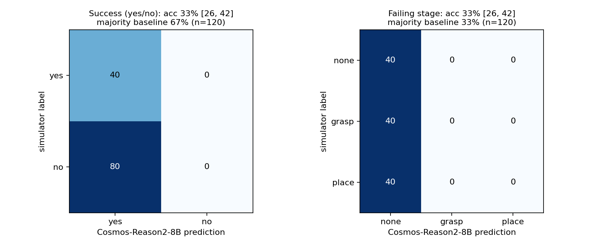

# Cosmos critic v1: Cosmos-Reason2-8B vs simulator labels

Model `nvidia/Cosmos-Reason2-8B` (self-hosted vLLM), prompt sha256 `309d056cd99e17d4`, code commit `9715a642cd66`. Clips: 120 UR5e/UR10e block-to-tray rollouts (gap_budget_v2 dev seeds 0-59, balanced per stage: {'place': 40, 'grasp': 40, 'none': 40}). fps=4, max_tokens=4096, temperature=0.6.

Parsed answers: 120/120 (unparsed count as wrong); truncated: 0.

| task | Cosmos accuracy | majority-class baseline | uniform chance |
|---|---|---|---|
| success yes/no | 33.3% (40/120), Wilson 95% [25.5, 42.2] | 66.7% (80/120), Wilson 95% [57.8, 74.5] ('no') | 50% |
| failing stage (none/grasp/place) | 33.3% (40/120), Wilson 95% [25.5, 42.2] | 33.3% (40/120), Wilson 95% [25.5, 42.2] ('place') | 33% |

## Per-class precision / recall

| task | class | support | predicted | precision | recall |
|---|---|---|---|---|---|
| success | yes | 40 | 120 | 33% | 100% |
| success | no | 80 | 0 | - | 0% |
| stage | none | 40 | 120 | 33% | 100% |
| stage | grasp | 40 | 0 | - | 0% |
| stage | place | 40 | 0 | - | 0% |

## Confusion (rows = simulator, columns = Cosmos)

**success**

| sim \ cosmos | yes | no | unparsed |
|---|---|---|---|
| yes | 40 | 0 | 0 |
| no | 80 | 0 | 0 |

**stage**

| sim \ cosmos | none | grasp | place | unparsed |
|---|---|---|---|---|
| none | 40 | 0 | 0 | 0 |
| grasp | 40 | 0 | 0 | 0 |
| place | 40 | 0 | 0 | 0 |

Predicted stage distribution: {'none': 120, 'grasp': 0, 'place': 0}.
**The critic gave the same answer ('none') for every clip: it does not discriminate outcomes on this set, and its accuracy equals that class's share.**

Internal consistency (success=yes iff stage=none): 120/120.
Latency per request (with 3 concurrent requests): median 9.0 s, max 17.6 s.

Serving: vLLM on one L40S, command in `serve_vllm.sh`; per-request `media_io_kwargs` {video: {fps: 4}} (vLLM samples the frames) with `do_sample_frames: false`. Receipts (response id, tokens, latency, reasoning, answer) per clip in `receipts/`.

## Caveats

- simulator renders, not real video; one fixed third-person camera, 640x480
- classes balanced by construction (sampled per stage), so accuracy is not the deployment-mix accuracy
- one sample per clip at temperature 0.6 (model-card reasoning defaults), seed 1234
- the failing-stage definitions are ours; the model was not fine-tuned on them
