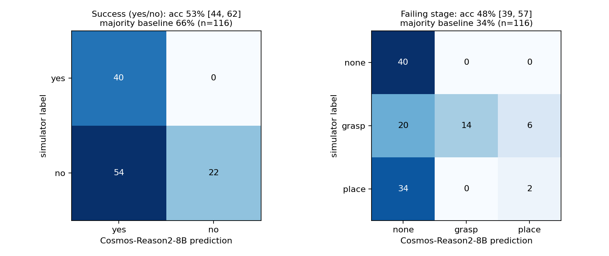

# Cosmos critic v2: Cosmos-Reason2-8B vs simulator labels

Model `nvidia/Cosmos-Reason2-8B` (self-hosted vLLM), prompt `obs`, camera `close`, prompt sha256 `9b1e2d29448b883d`, code commit `5973b39608c7`. Clips: 116 UR5e/UR10e block-to-tray rollouts (gap_budget_v2 conditions, v2 seeds 2020-2079, balanced per stage: {'none': 40, 'place': 36, 'grasp': 40}). fps=4, max_tokens=4096, temperature=0.6.

Parsed answers: 116/116 (unparsed count as wrong); truncated: 0.

| task | Cosmos accuracy | majority-class baseline | uniform chance |
|---|---|---|---|
| success yes/no | 53.4% (62/116), Wilson 95% [44.4, 62.3] | 65.5% (76/116), Wilson 95% [56.5, 73.5] ('no') | 50% |
| failing stage (none/grasp/place) | 48.3% (56/116), Wilson 95% [39.4, 57.3] | 34.5% (40/116), Wilson 95% [26.5, 43.5] ('none') | 33% |

## Per-class precision / recall

| task | class | support | predicted | precision | recall |
|---|---|---|---|---|---|
| success | yes | 40 | 94 | 43% | 100% |
| success | no | 76 | 22 | 100% | 29% |
| stage | none | 40 | 94 | 43% | 100% |
| stage | grasp | 40 | 14 | 100% | 35% |
| stage | place | 36 | 8 | 25% | 6% |

## Confusion (rows = simulator, columns = Cosmos)

**success**

| sim \ cosmos | yes | no | unparsed |
|---|---|---|---|
| yes | 40 | 0 | 0 |
| no | 54 | 22 | 0 |

**stage**

| sim \ cosmos | none | grasp | place | unparsed |
|---|---|---|---|---|
| none | 40 | 0 | 0 | 0 |
| grasp | 20 | 14 | 6 | 0 |
| place | 34 | 0 | 2 | 0 |

Predicted stage distribution: {'none': 94, 'grasp': 14, 'place': 8}.
Raw observational answers: {'cube_last_frame': {'tray': 94, 'table': 22}, 'cube_left_table': {'yes': 100, 'no': 16}}.
Static negative controls (arm never moves; excluded from the metrics above): 0/6 answered success.

Internal consistency (success=yes iff stage=none): 116/116.
Latency per request (with 3 concurrent requests): median 11.0 s, max 75.8 s.

Serving: vLLM on one L40S, command in `serve_vllm.sh`; per-request `media_io_kwargs` {video: {fps: 4}} (vLLM samples the frames) with `do_sample_frames: false`. Receipts (response id, tokens, latency, reasoning, answer) per clip in `receipts/`.

## Caveats

- simulator renders, not real video; camera config 'close': {'views': [{'lookat': [0.45, 0.05, 0.11], 'distance': 0.42, 'azimuth': 180.0, 'elevation': -18.0}], 'size': [480, 640]}
- classes balanced by construction (sampled per stage), so accuracy is not the deployment-mix accuracy
- one sample per clip at temperature 0.6 (model-card reasoning defaults), seed 1234
- the failing-stage definitions are ours; the model was not fine-tuned on them
- success and stage are derived in code from the observational answers (cube in tray -> success; else lifted -> place, not lifted -> grasp)
